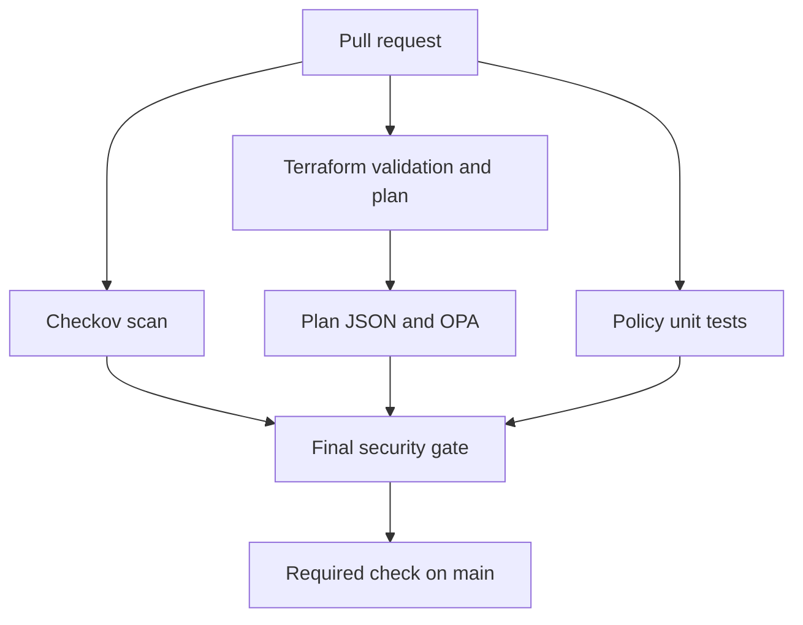

# DevSecOps Automated Security Gate & Policy-as-Code Lab

A 12-week university and portfolio project to evaluate AWS S3 Terraform configurations before merge using Checkov, Open Policy Agent (OPA), and GitHub Actions.

**Status: planning and repository organization.** Terraform configurations, Rego policies, CI execution, and merge enforcement are not implemented yet. This repository does not currently block insecure changes.

## Start here

1. Read the [project plan](docs/project.md), which covers all ten instructor requirements.
2. Follow the [first milestone checklist](docs/catch-up.md).
3. Record actual setup in the [implementation log](docs/implementation.md).
4. Track results in the [test matrix](docs/test-results.md) and [weekly log](docs/weekly-log.md).
5. Use [GitHub Issues](https://github.com/Kachilli6/automated_security_gate_policy_as_code/issues) for the implementation backlog.

## Goal and scope

Build a reproducible gate that rejects documented S3 policy violations and lets compliant changes proceed to review. Start with one provider, root-module Terraform examples, and four proposed controls: public access blocking, explicit SSE-KMS, versioning, and ownership/environment tags.

No automatic cloud deployment is planned. Passing the selected rules does not imply complete security or CIS certification.

## Target architecture

Terraform produces the saved plan and exports JSON; OPA evaluates it. The final gate must reject failed or skipped prerequisites. GitHub branch protection or a ruleset must require the check before it can enforce merging.

## Repository guide

| Path | Purpose |
| --- | --- |
| [configs/](configs/) | Normal Terraform scan target; implementation pending |
| [examples/insecure/](examples/insecure/) | Isolated expected-failure examples |
| [policy/](policy/) | Rego policies and unit tests |
| [tests/fixtures/](tests/fixtures/) | Labelled synthetic policy inputs |
| [scripts/](scripts/) | Local wrappers and example test harness |
| [docs/](docs/) | Research, schedule, progress, evidence, and troubleshooting |
| [.github/](.github/) | Contribution templates, ownership, and future CI |
| [docs/archive/original-project.md](docs/archive/original-project.md) | Preserved initial proposal; superseded |

Folder guides are scaffolding, not runnable implementations.

## Working on the project

Create a feature branch, make a small change, record reproducible evidence, and open a pull request using the template. Consult [CONTRIBUTING.md](CONTRIBUTING.md). Tool installation and pinned versions will be documented when verified.

**Next milestone:** one valid Terraform example, one Checkov pass/fail pair, and one Rego rule with positive and negative tests. See the [control catalogue](docs/policy-catalog.md) and [security assumptions](docs/security-model.md).
